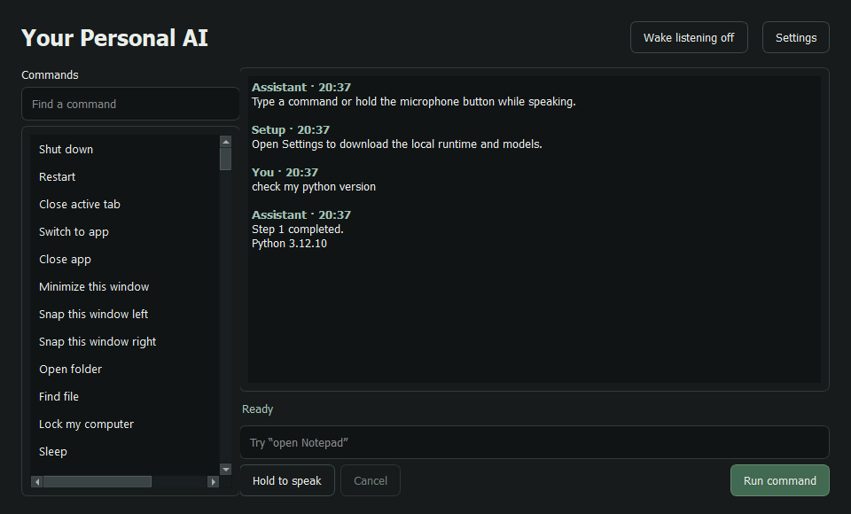

# Your Personal AI

Your Personal AI is a Windows tray assistant that runs English voice and text commands locally. Say `Hey Assistant`, wait for the tone, then say `snap this window left`. It acts on the window you were using before the assistant opened.



## Try it from source

On 64-bit Windows (x64), install Git and uv. Run these commands in PowerShell to create the Python 3.12 environment and open the assistant. [Install uv](https://docs.astral.sh/uv/getting-started/installation/)

```powershell
git clone https://github.com/IshanRai9/your-personal-ai.git
cd your-personal-ai
uv sync --locked --python 3.12
uv run --locked personal-ai
```

Type `open Notepad` and press Enter to try an exact command. For speech and natural-language requests, open **Settings → General → Download / repair local models**. First-time setup needs internet access and several GB of disk space. Once setup finishes, enable **Wake listening** or hold **Hold to speak**.

## Example commands

| Say or type | What happens |
| --- | --- |
| `switch to Chrome` / `snap this window left` | Brings an open app forward or arranges the selected window. |
| `close this tab` / `close Discord` | Requests a normal tab or app close so the app handles unsaved work. |
| `open Downloads` / `find budget.xlsx` | Opens Explorer or lists matching paths in your local personal folders. |
| `capture this window` | Saves a PNG locally and displays its path. |
| `mute audio for Discord` | Mutes that app's playback sessions. |
| `shutdown` | Listens for a fresh recording of the passphrase you set in Settings. |

Custom commands can chain app launches and scripts. Closing the assistant window keeps it in the tray. See the [user guide](docs/usage.md) for workflow setup, wake timing, supported tabbed apps, startup, and local data locations.

## How commands run

- **Speech.** Vosk listens for the wake phrase. A local voice activity detector ends command capture after a pause. Faster-whisper transcribes the audio in memory.
- **Command selection.** Exact phrases resolve directly. For other requests, Qwen3 4B Instruct runs through Ollama on loopback. Its structured response selects an available command, asks for clarification, or reports an unknown request.
- **Execution.** Python dispatches the selected command to Windows APIs or a user-configured workflow. Windows handles administrator approval through UAC.
- **Privacy.** Speech recognition and model inference run offline after setup. Recent activity stays in memory. The app stores settings, models, and requested screenshots under `%LOCALAPPDATA%\YourPersonalAI`. Programs and scripts you launch retain their own network behavior.

## Standalone Windows build

```powershell
uv run --locked python scripts/build_windows.py
```

Copy the entire `dist\YourPersonalAI` folder to a permanent location and double-click `YourPersonalAI.exe`. Keep the companion `_internal` folder beside it. The packaged app includes Python. To add Start Menu and sign-in shortcuts, run `.\YourPersonalAI.exe --install` from that permanent folder.

Maintainers can also run **Actions → Windows checks → Run workflow** to test, build, and download the portable bundle from that run's artifacts.

## Development checks

```powershell
uv run --locked ruff check .
uv run --locked ruff format --check .
uv run --locked python -m unittest discover -s tests -v
```

The Windows test suite covers command resolution, local settings, wake timing, GUI flows, and Windows integration. Tests intercept disruptive power actions and can run before downloading the models.
